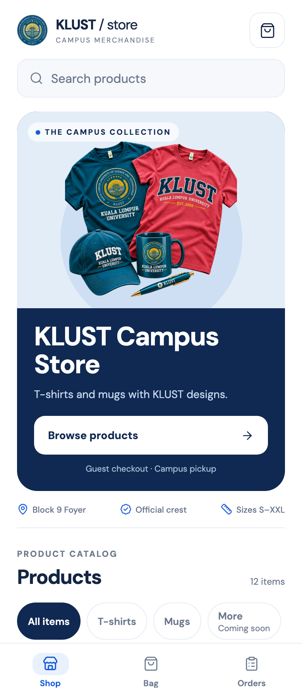
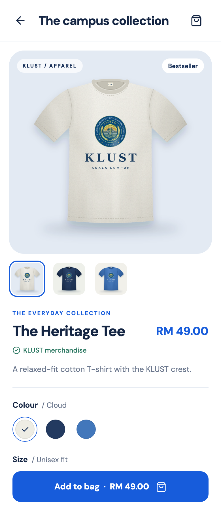
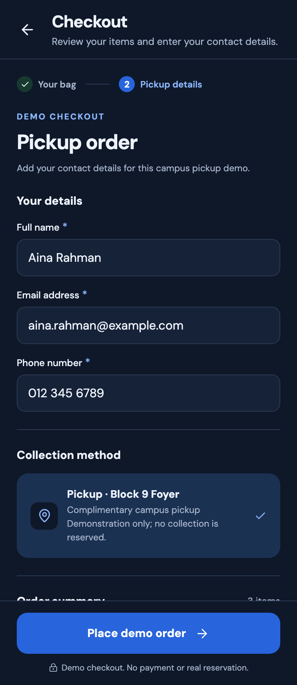
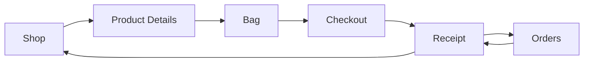

# KLUST Campus Store
# (CSC 3563 MOBILE PROGRAMMING ASSIGNMENT)

A campus merchandise shopping demo built with **Expo, React Native, and TypeScript**. Discover twelve T-shirts and mugs, choose your colours and sizes, and complete a simulated pickup order.

**[Open the live demo →](https://abdullahwarrg-png.github.io/klust-campus-store/)** · [Project report](docs/KLUST_Campus_Store_Report.docx) · [Validation notes](docs/VALIDATION.md)

[](https://github.com/abdullahwarrg-png/klust-campus-store/actions/workflows/pages.yml)

## Preview

|                                                  Shop                                                   |                                              Product details                                              |                                                 Checkout                                                  |
| :-----------------------------------------------------------------------------------------------------: | :-------------------------------------------------------------------------------------------------------: | :-------------------------------------------------------------------------------------------------------: |
|  |  |  |


- Light theme with blue accents, phone-width layouts, and inputs sized to avoid automatic mobile focus zoom.
- Search, category filtering, and featured or price sorting across **eight T-shirts and four mugs**.
- Select **More · Coming soon** to preview upcoming campus favourites.
- Choose matching product colour images, T-shirt sizes S–XXL, and quantities.
- Build a persistent bag with separate colour/size variants and a ten-unit limit per variant.
- Complete validated guest checkout for complimentary pickup at **Block 9 Foyer**.
- Reopen saved receipts from Orders, including after a browser reload.

**This is a demonstration store.** No payment, email, real stock reservation, or pickup booking is created. Use fictional contact details. Shopping records stay in the current browser/device; clearing its storage removes them. The university is not represented as operating this demo.

## Run locally

Use **Node.js 24 LTS** and npm.

```sh
git clone https://github.com/abdullahwarrg-png/klust-campus-store.git
cd klust-campus-store
npm ci
npm run web
```

For mobile development:

```sh
npm start          # Expo development server
npm run android   # configured Android emulator/device
npm run ios       # iOS simulator; macOS and Xcode required
```

A physical phone needs an Expo Go release compatible with **SDK 58**, or a matching development build. Keep the phone and computer on the same network. Native bundles have been exported; physical-device and simulator interaction have not been verified.

## Verify

```sh
npm run typecheck
npm run lint
npm test
npm run format:check
npm run export
```

The last command exports Android, iOS, and web bundles into ignored `dist/`; it does not create an APK or IPA.

To reproduce the browser walkthrough:

```sh
npx playwright install chromium
npm run export:web
npx serve dist -l 8082
```

In another terminal:

```sh
npm run verify:web -- http://localhost:8082
```

The walkthrough refreshes three screenshots and `docs/verification.json`. It tests category previews, filtering, variants, cart totals, reload persistence, validation, storage failure recovery, duplicate submission, receipts, pickup information, narrow layouts, desktop layout, keyboard focus, and runtime errors. The current record contains **19 passing logic tests and 13 passing browser scenario groups**. See [validation details and limits](docs/VALIDATION.md).

## Architecture

```text
App.tsx                 Fonts, safe area, application shell
src/components/         Shared controls, product cards, images, cart rows
src/data/               Product catalog, category metadata, pickup location
src/navigation/         Typed native stack and bottom tabs
src/screens/            Shop, Product, Cart, Checkout, Receipt, Orders
src/state/              Shared cart/order state and queued persistence
src/theme/              Blue palette, typography, shared design values
src/types/              Product, customer, cart, and order models
src/utils/              Pure calculations, validation, restoration, reducer
tests/                  Shopping logic tests
scripts/                Browser walkthrough and temporary asset generator
docs/                   Report, screenshots, verification, image guide
```



Shop, Bag, and Orders use bottom tabs. Product Details, Checkout, and Receipt use a native stack. Routes pass identifiers; `useShop()` owns shared data. Prices use integer sen and are formatted as MYR only for display.

Cart lines are identified by product, colour, and size. Writes to AsyncStorage run sequentially, and checkout saves the completed order before clearing the bag. Historical receipts retain item names and prices independently of the current catalog. Upcoming category metadata is separate from purchasable product types, so upcoming items cannot enter checkout.

## Deployment

[GitHub Actions](.github/workflows/pages.yml) runs checks and deploys the web export to GitHub Pages on pushes to `main`. Pull requests run checks and build without deployment. Pages uses **GitHub Actions** as its build source.

`app.config.ts` reads `EXPO_PUBLIC_BASE_URL`. The deployment workflow sets it to `/klust-campus-store` so scripts, fonts, and images resolve under the repository URL. Local development defaults to the domain root.

```sh
EXPO_PUBLIC_BASE_URL=/klust-campus-store npm run export:web
```

If you fork or rename the repository, change the workflow base path and the demo/README links. Native exports do not depend on the Pages deployment. The live site uses the same local-only storage model as development.

## Report and assets

The [Word report](docs/KLUST_Campus_Store_Report.docx) documents the implemented flow, architecture, code examples, verification, and screenshots. It uses 11.5 pt body text, 14 pt bold main headings, 11.5 pt bold subheadings, and monospaced code styles.

The catalog uses **temporary project illustrations**, with matching colour variants. Follow the [image replacement guide](docs/IMAGE_GUIDE.md) to substitute final photos. `npm run assets` overwrites those illustrations; do not run it over replacement photography.

Credits:

- [KLUST](https://klust.edu.my/) and [official logo source](https://klust.edu.my/wp-content/uploads/2026/03/logo-klust.png), accessed 3 November 2026. University branding remains its owner's property.
- Campaign image supplied for this project; catalog illustrations generated locally.
- DM Sans through `@expo-google-fonts/dm-sans`, SIL Open Font License.
- Lucide icons, ISC license; Expo and other dependencies retain their respective licenses.
- The existing [MIT license](LICENSE) retains the Expo starter copyright notice; it does not grant rights to university trademarks.

## Next steps

Real fulfillment would require a backend, server-validated inventory and prices, secure customer records, and campus pickup operations. Accounts, payments, and cross-device history are outside this demo. Native keyboard, hardware Back, screen-reader, and physical-device checks remain future validation work.

### Mobile browser verification

Run `npx playwright install chromium webkit`, then `npm run verify:mobile` against the local export (or append the live demo URL). It checks Chromium and WebKit at 320, 390, 430, and 600 px, including full-width layout, normal viewport scale, and checkout input focus. Browser emulation does not replace physical-device testing.
